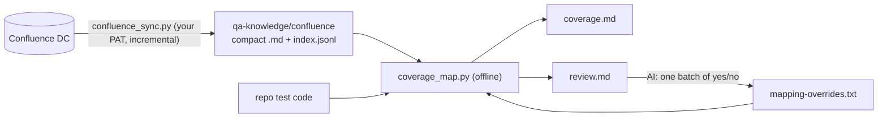
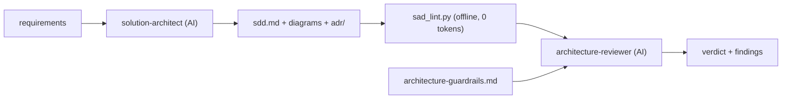

# ai_library

My skills and agents for **Claude Code** and the **GitHub Copilot coding agent**, focused on Java/Python test automation, QA and solution architecture.

One source of truth: everything is written once in Claude Code plugin layout. Skills use the shared `SKILL.md` format that both tools understand. Agents are converted to Copilot's `.agent.md` format when installed.

## What's inside

| Plugin | Type | Name | Purpose |
|---|---|---|---|
| `java-testing` | skill | `junit5-tests` | JUnit Jupiter structure, naming, parameterized tests, JUnit 4 migration |
| | skill | `assertj-mockito` | Idiomatic assertions and mocks, when not to mock |
| | skill | `rest-assured-api-tests` | API test framework layout, specs, schema validation, negative cases |
| | skill | `ui-e2e-java` | Selenide / Playwright-Java page objects, locators, waits, traces |
| | skill | `maven-gradle-test-setup` | Surefire/Failsafe, Gradle suites, tags, parallel runs, Allure, JaCoCo |
| `qa-agents` | agent | `test-planner` | Story/diff → risk-based test plan |
| | agent | `test-case-writer` | Plan → manual cases or automated tests, runs them |
| | agent | `flaky-test-investigator` | Reproduces flaky tests, finds and fixes root cause |
| | agent | `bug-report-writer` | Failure/log → reproducible bug report |
| | agent | `test-code-reviewer` | Reviews test code quality and coverage gaps |
| | skill | `test-case-format` | Test case / test plan format and design techniques |
| | skill | `bug-report-template` | Bug report format and rules |
| `confluence-coverage` | skill | `confluence-coverage` | Confluence (Server/DC) features ↔ test plans/strategies/cases ↔ automated tests, gap report. No MCP; scripts do the work |
| `bdd-suite-optimizer` | skill | `cucumber-suite-analysis` | Cucumber E2E suite: risk, coverage, redundancy, test-level advice, coverage-driven golden set. Scripts do the work |
| | agent | `e2e-suite-optimizer` | Reviews uncertain calls in small batches, plans moves to component/unit tests |
| | agent | `coverage-mapper` | Resolves ambiguous matches in one batch, answers coverage questions on a tight token budget |
| `solution-architecture` | skill | `solution-design-doc` | Solution design document (SDD) template, C4 diagrams as code (Mermaid / PlantUML / draw.io), measurable NFRs, ADRs |
| | skill | `architecture-review` | Two-lens review checklist (solution + enterprise), guardrails template, `sad_lint.py` structural linter |
| | agent | `solution-architect` | Requirements → SDD + diagrams + ADRs, self-checked with the linter |
| | agent | `architecture-reviewer` | Architecture-board style review: verdict + severity-ranked findings. Read-only |

## Confluence coverage (no MCP, low AI cost)

Python scripts (standard library only) do the expensive part locally at zero AI cost. The AI only decides the few ambiguous matches, and those decisions are stored so they're never paid for twice.



1. Install into your work repo:
   ```bash
   tools/.venv/bin/ailib install --target ~/work/my-repo --plugins java-testing,qa-agents,confluence-coverage
   ```
2. Copy `.github/skills/confluence-coverage/templates/confluence-coverage.toml` to the repo root and set your spaces, feature folders and QA folders.
3. Sync, then map, in your own terminal:
   ```bash
   CONFLUENCE_URL=https://confluence.corp CONFLUENCE_PAT=… python .github/skills/confluence-coverage/scripts/confluence_sync.py
   ```
   ```bash
   python .github/skills/confluence-coverage/scripts/coverage_map.py
   ```
4. Open `qa-knowledge/coverage.md`. Optionally ask the `coverage-mapper` agent to resolve `qa-knowledge/review.md` in one request.

Only need specific pages? Pass links from any space; each page comes with its child pages:
```bash
python .github/skills/confluence-coverage/scripts/confluence_sync.py --page "https://confluence.corp/pages/viewpage.action?pageId=123" --page "https://confluence.corp/display/PAY/SDD+Design" --max-depth 3
```

## Shrink a Cucumber E2E suite (risk · coverage · redundancy · golden set)

`bdd_suite.py` parses every `.feature` file and the Java step definitions offline. For each scenario it works out:
- which systems it touches (REST, DB, Kafka/MQ, CSM simulator, files);
- its payment outcomes and checks (accepted, rejected, returned, recalled, timeout, mandate, screening, cut-off, validation…);
- a risk score;
- duplicates, near-duplicates and subsumed scenarios.

It then gives every scenario a tier: **golden** (coverage-driven minimal E2E set), **e2e** (extended/nightly), **component**, **unit**, **merge** or **drop**. The AI (`e2e-suite-optimizer`) only reviews small batches of uncertain or high-risk calls.

```bash
tools/.venv/bin/ailib install --target ~/work/e2e-repo --plugins bdd-suite-optimizer,confluence-coverage
```
```bash
cd ~/work/e2e-repo && python .github/skills/cucumber-suite-analysis/scripts/bdd_suite.py
```
Outputs go to `qa-knowledge/e2e/`:
- `summary.md`
- `golden-set.md` and `golden-set.rerun.txt` (run it with `-Dcucumber.features=@qa-knowledge/e2e/golden-set.rerun.txt`)
- `moves.md`
- `scenarios.csv`
- `review-NN.md`

Decisions go in `decisions.txt`. Tune `bdd-suite.toml` `[layers]` with your client/stub class names for the best results.

## Confluence + E2E together

The agents can't call each other, so they cooperate through the shared `qa-knowledge/` folder. Run them in this order:

| Step | Who | Cost | Output |
|---|---|---|---|
| 1. `confluence_sync.py --page <links>` | you (token stays in your terminal) | 0 | `qa-knowledge/confluence/` |
| 2. `qa_refresh.py` | script: `coverage_map.py` → `bdd_suite.py` | 0 | `coverage.*`, `review.md`, `e2e/*` |
| 3. `coverage-mapper` | AI, decides `review.md` | 1 request | `mapping-overrides.txt` (curated features) |
| 4. `qa_refresh.py` | script | 0 | scenarios linked to the curated features |
| 5. `e2e-suite-optimizer` | AI, one `review-NN.md` per request | ~1 request per 20 items | `e2e/decisions.txt` |
| 6. `qa_refresh.py`, then read `e2e/feature-impact.md` | script, then you or either agent | 0–1 | per-feature before/after view |

```bash
python .github/skills/cucumber-suite-analysis/scripts/qa_refresh.py
```
- The last line printed by `qa_refresh.py` always names the next step.
- Every Confluence feature that has scenarios keeps at least one golden E2E scenario.
- In `e2e/feature-impact.md`:
  - `ONLY_LOWER`: a feature that would lose all its E2E scenarios;
  - `NO_E2E`: a feature that had none to begin with.

A first full cycle costs about 5 requests; later cycles only cost requests for new or changed items.

## Solution design: create and review (solution + enterprise lens)

A **solution architect** designs one solution for one business problem: requirements, quality targets, C4 views, ADRs and risks. An **enterprise architect** owns the whole landscape: principles, tech radar, shared platforms, data ownership and the roadmap. So documents are written at solution level and reviewed with both lenses.



1. Install into the repo where the design docs live:
   ```bash
   tools/.venv/bin/ailib install --target ~/work/my-repo --plugins solution-architecture
   ```
2. Optional, but needed for the enterprise lens: copy `.github/skills/architecture-review/templates/architecture-guardrails.md` to the repo root and fill in your principles, tech radar, shared platforms and data ownership.
3. Write a design with the `solution-architect` agent, or start from `.github/skills/solution-design-doc/templates/solution-design.md`.
4. Lint it before spending AI tokens on a review:
   ```bash
   python .github/skills/architecture-review/scripts/sad_lint.py docs/architecture/my-sdd.md
   ```
   The linter checks for:
   - missing sections and leftover TBD/TODO placeholders;
   - quality statements without a number ("highly available");
   - no context diagram;
   - elements drawn in a diagram but never described in the text (it parses Mermaid, PlantUML and `.drawio`, compressed or not);
   - broken links.

   Add `--json` for machine-readable output, or `--strict` to also fail on warnings.
5. Ask the `architecture-reviewer` agent to review it. You get a verdict (Approve / Approve with conditions / Rework), findings ranked Blocker, Major, Minor or Question, and questions for the authors.

Designs in Confluence: export them to Markdown, or fetch them with `confluence_sync.py --page <url>`. Keep the `.drawio` source (uncompressed) next to the document: diagrams that exist only as PNGs can't be cross-checked against the text.

## Use with Claude Code (plugin marketplace)

```bash
claude plugin marketplace add vitVitale/ai_library
```
```bash
claude plugin install java-testing@ai-library
```
```bash
claude plugin install qa-agents@ai-library
```
```bash
claude plugin install confluence-coverage@ai-library
```
```bash
claude plugin install bdd-suite-optimizer@ai-library
```
```bash
claude plugin install solution-architecture@ai-library
```
Or inside a session: `/plugin marketplace add vitVitale/ai_library`, then `/plugin`. Skills trigger automatically (or run `/java-testing:junit5-tests`); agents appear in `/agents`.

## Use with GitHub Copilot (install into a repo)

Copilot's coding agent only sees files committed in the repository, so copy the content in with `ailib`:

```bash
cd tools && python3 -m venv .venv && .venv/bin/pip install -e '.[dev]'
```
```bash
tools/.venv/bin/ailib install --target ~/IdeaProjects/my-service --dry-run
```
```bash
tools/.venv/bin/ailib install --target ~/IdeaProjects/my-service
```

This writes `.github/skills/<skill>/…`, `.github/agents/<agent>.agent.md` and `.ailib.lock.json` into the target repo. Commit them.

Options:
- `--plugins java-testing,qa-agents`: choose plugins (default: same as last install, else all). Plugins you leave out are removed from the target.
- `--for copilot|claude|both`: `claude` writes `.claude/skills` and `.claude/agents` instead, for teammates without the plugin.
- Re-run anytime to update. Files you edited locally, or files ailib didn't create, are never overwritten or deleted without `--force`.

## Develop

```bash
cd tools && .venv/bin/pytest -q && .venv/bin/ailib validate
```
```bash
claude plugin validate .
```
See [docs/authoring.md](docs/authoring.md) for how to write skills and agents.
