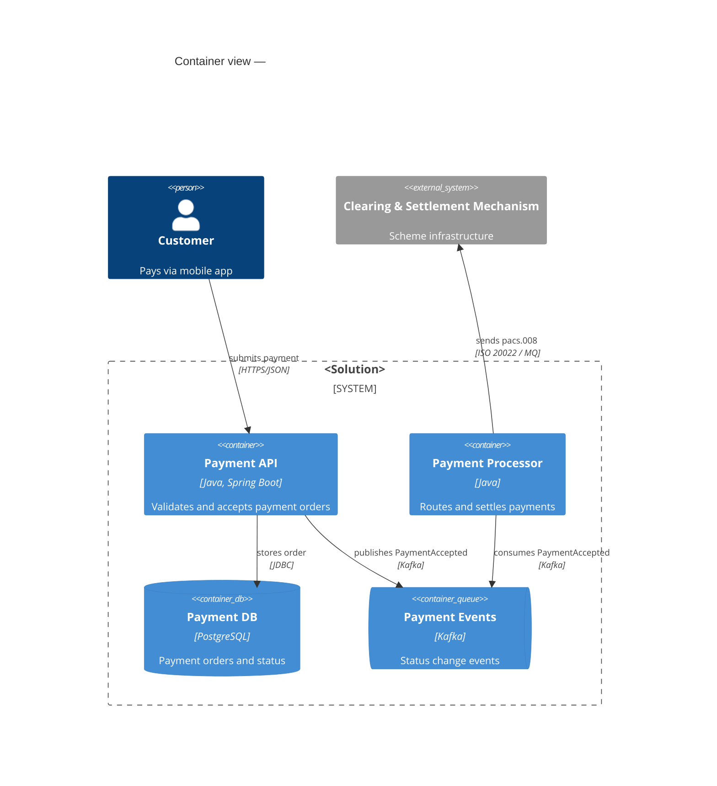
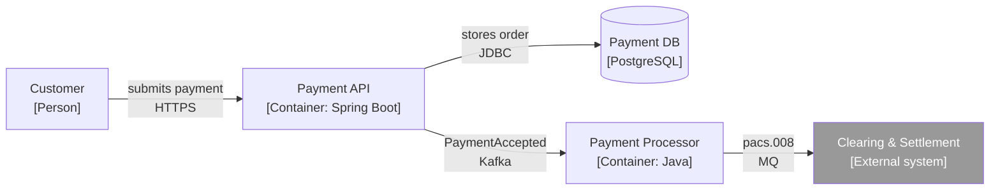
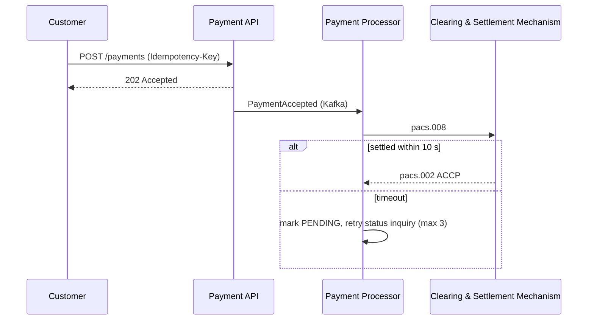
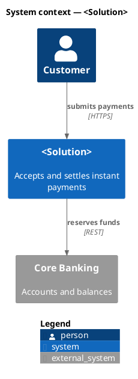

# Architecture diagrams: C4 conventions and diagram-as-code

## Which diagrams an SDD needs
| View | C4 level | Shows | Required? |
|---|---|---|---|
| System context | 1 | The solution as **one box**, its users (people) and external systems | Always |
| Container | 2 | Runnable/deployable units: apps, services, databases, queues, and the protocols between them | Always |
| Component | 3 | Inside one container: the major modules | Only for a complex or risky container |
| Dynamic / sequence | — | Runtime order of calls for a key flow, **including one failure path** | 2–4 key flows |
| Deployment | — | Environments, regions/zones, clusters, network zones, scaling | When infra is new or changes |

Don't draw code-level (level 4) diagrams in an SDD.

## Rules for every diagram (reviewers check these)
1. **Title** naming the view and scope: "Container view — Instant Payments".
2. **Every element** has a name, a type (person / system / container / DB / queue) and, from level 2 down, its technology.
3. **Every arrow** is one-directional and labelled with *verb + what* and the protocol/style: "sends payment status [Kafka, async]". No unlabelled lines, and no double-headed arrows.
4. **External systems look different** (`_Ext`, grey) and **trust boundaries** (internet, DMZ, internal, third party) are drawn.
5. **Legend** whenever colours or shapes carry meaning.
6. **About 15–20 elements at most.** If it's larger, split it into separate views.
7. **The diagram and the text agree.** Every element in a diagram is described in the text (responsibility, owner) using **the same name**, and so are the important arrows. The `sad_lint.py` consistency check enforces this.
8. **One abstraction level per diagram.** Don't mix containers with classes.
9. Keep diagrams **as code or as editable source** (`.mmd`, `.puml`, `.drawio`) in version control next to the document. A PNG on its own can't be reviewed or diffed.

## Tool choice
- **Mermaid**: renders in GitHub/GitLab and in many IDEs. Use `C4Context`/`C4Container` or a plain `flowchart` with C4-style labels. Confluence Server/DC needs a Mermaid macro app; if you don't have one, export SVG.
- **C4-PlantUML**: the most complete C4 notation. Confluence DC has PlantUML macros.
- **draw.io / diagrams.net**: the usual choice in Confluence DC. Also save the `.drawio` file in the repo, uncompressed (*File → Properties → Compressed* off) so it diffs cleanly; `sad_lint.py` reads both formats. Use the C4 shape library.

Match whatever the project already uses.

## Mermaid: container view

## Mermaid: flowchart fallback (renders everywhere)

## Mermaid: sequence with failure path

## C4-PlantUML: context view

