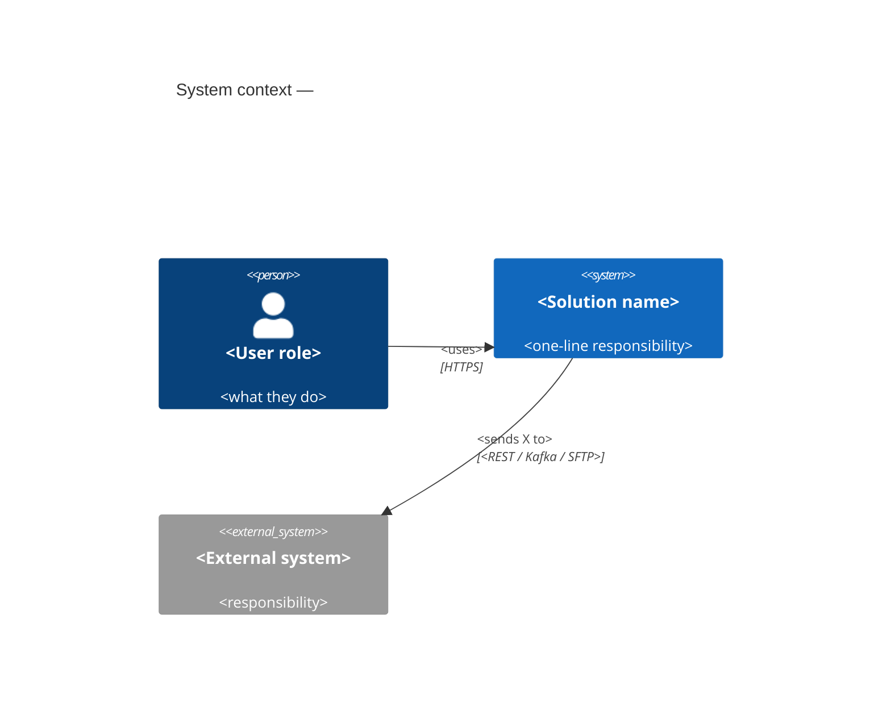

# <Solution name> — Solution Design

| Status | Draft / In review / Approved | Version | 0.1 |
|---|---|---|---|
| Owner | <solution architect> | Last updated | <YYYY-MM-DD> |
| Reviewers | <dev lead, security, ops, EA board> | Decision forum | <architecture board / date> |

## 1. Context and problem
<!-- 3–6 sentences: business problem, who has it, why now, what happens if we do nothing. Link the business case / requirements page. -->

## 2. Goals, non-goals and scope
**Goals** (measurable outcomes):
- <goal with a metric, e.g. "settle instant payments end-to-end in < 10 s p99">

**Non-goals** (explicitly out of scope):
- <thing people might assume is included>

**In scope / out of scope** systems, channels, countries, user groups: <list>

## 3. Stakeholders and concerns
| Stakeholder | Concern |
|---|---|
| <ops team> | <on-call load, runbooks> |

## 4. Requirements
### 4.1 Functional requirements
| ID | Requirement / use case | Priority |
|---|---|---|
| FR-1 | <actor> can <action> so that <outcome> | Must |

### 4.2 Quality attributes (non-functional requirements)
Every row needs a measurable target: an adjective without a number is not a requirement.

| ID | Attribute | Scenario (stimulus → response) | Target |
|---|---|---|---|
| QA-1 | Performance | <N> payment requests/s at peak → response returned | p99 < <x> ms at <N> TPS |
| QA-2 | Availability | Primary zone fails → service continues | 99.95 % monthly, failover < <x> min |
| QA-3 | Recoverability | Data centre loss | RPO <x> min, RTO <y> min |
| QA-4 | Security | <threat> | <control / standard> |

### 4.3 Constraints
<!-- Fixed by others: regulation, mandated platforms, budget, deadlines, team skills, existing contracts. -->

## 5. Solution overview
### 5.1 System context (C4 level 1)
<!-- The solution as one box; users and external systems around it. Every arrow labelled "verb + protocol". -->

Describe each element in a sentence: why it's there and who owns it.

### 5.2 Containers (C4 level 2)
<!-- Deployable/runnable units (apps, services, DBs, queues) and how they talk. -->
<container diagram — see diagrams reference>

| Container | Responsibility | Technology | Owner |
|---|---|---|---|
| <API Gateway> | <…> | <…> | <team> |

### 5.3 Key flows
<!-- Sequence diagrams for the 2–4 most important or riskiest flows, including one failure path. -->

## 6. Data
| Entity / dataset | System of record | Classification (PII, PCI…) | Retention | Volume / growth |
|---|---|---|---|---|

Data flows that leave the trust boundary, plus consistency model (strong / eventual), migration of existing data.

## 7. Integration and interfaces
| Interface | Provider → consumer | Style (sync REST / async event / batch) | Contract (OpenAPI/AsyncAPI link) | SLA / volume | Error handling |
|---|---|---|---|---|---|

## 8. Security and compliance
- Authentication / authorisation: <IdP, token type, service-to-service auth>
- Data protection: <encryption in transit / at rest, key management, masking>
- Trust boundaries and threat model: <link or top threats + mitigations>
- Compliance: <PSD2 / GDPR / PCI-DSS / internal policy> and how it's met
- Audit logging: <what, where, retention>

## 9. Deployment and infrastructure
<!-- Deployment diagram: environments, regions/zones, clusters, network zones, scaling units. -->

## 10. Operations and resilience
- Observability: <metrics, logs, traces, dashboards, alerts mapped to QA targets>
- Resilience: <timeouts, retries + idempotency, circuit breakers, back-pressure, degradation modes>
- Disaster recovery and backup: <how RPO/RTO are achieved, tested how often>
- Capacity and cost: <sizing assumptions, cost estimate per month>
- Support model: <on-call owner, runbooks>

## 11. Testing approach
<!-- How the quality attributes and integrations will be verified: contract tests, performance tests vs QA targets, resilience/chaos tests, test environments and data. -->

## 12. Architecture decisions
| ADR | Decision | Status |
|---|---|---|
| [ADR-001](adr/ADR-001-<slug>.md) | <decision in one line> | Accepted |

## 13. Alternatives considered
| Option | Pros | Cons | Why not chosen |
|---|---|---|---|

## 14. Risks, assumptions and open questions
| Type | Description | Impact | Mitigation / owner / due |
|---|---|---|---|
| Risk | <…> | High | <…> |
| Assumption | <…> | | <how it will be validated> |
| Open question | <…> | | <who decides, by when> |

## 15. Enterprise alignment
- Principles / standards followed: <link to guardrails>
- Reused enterprise capabilities / platforms: <…>
- Deviations from standards (each needs an ADR and a waiver): <none / list>

## 16. Transition and rollout
<!-- Migration steps, feature flags, coexistence with legacy, cut-over, rollback plan, decommissioning. -->

## 17. Glossary
| Term | Meaning |
|---|---|
